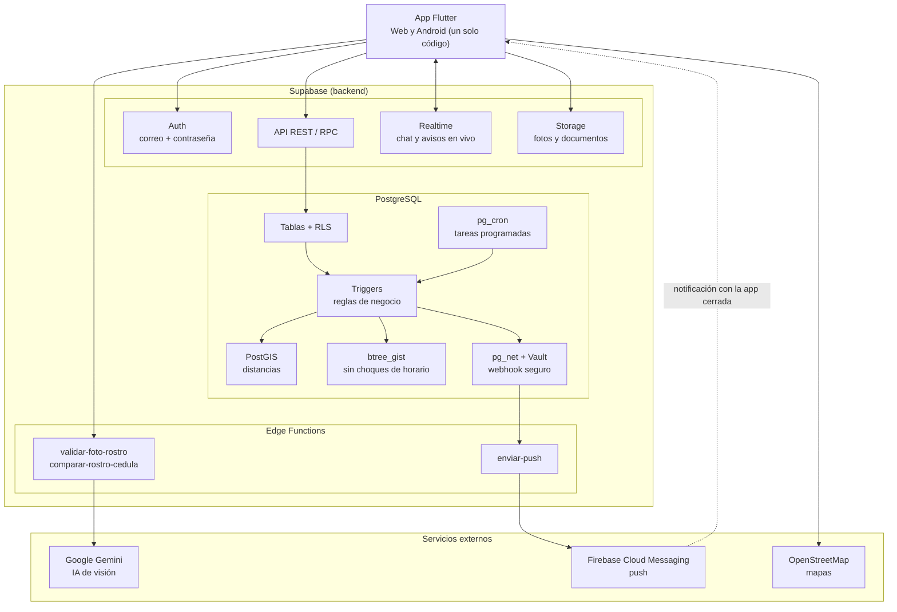
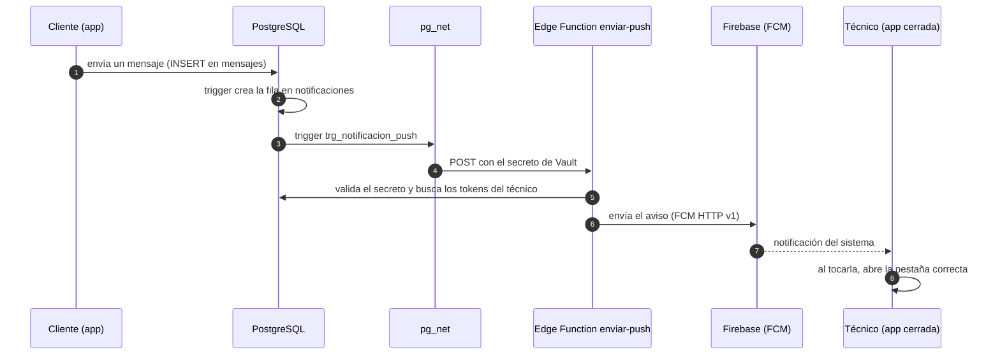
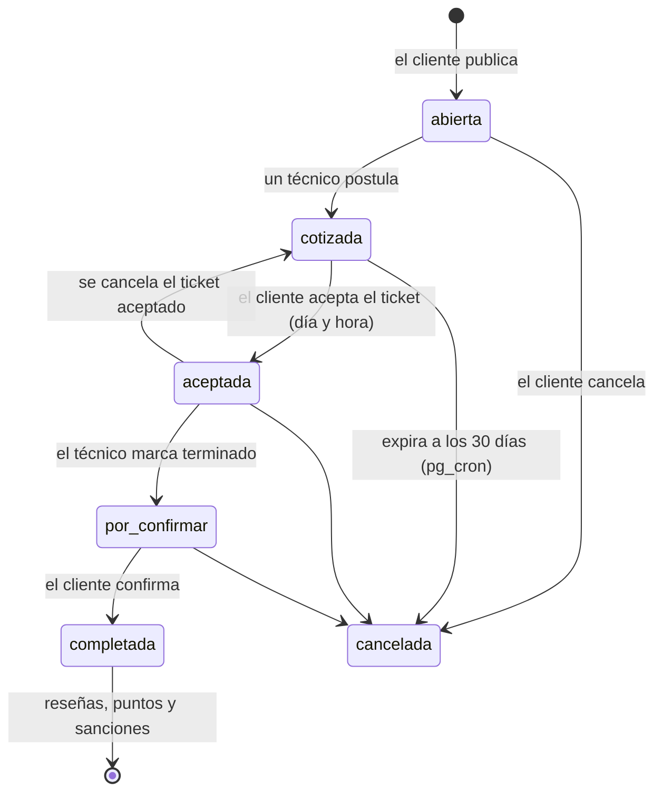
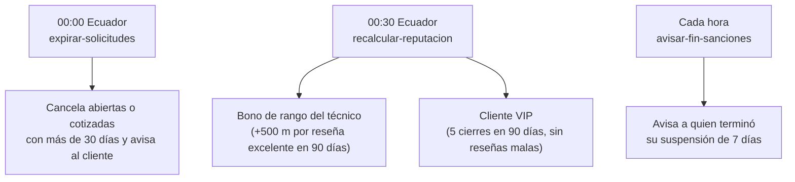

# ChauchaApp: diagramas de arquitectura

Los diagramas están en Mermaid. GitHub los dibuja solo al abrir este archivo;
también se pueden pegar en https://mermaid.live para exportarlos como PNG o SVG.

## 1. Vista general

## 2. Cómo llega una notificación push

## 3. Vida de una solicitud

## 4. Tareas programadas (pg_cron)

