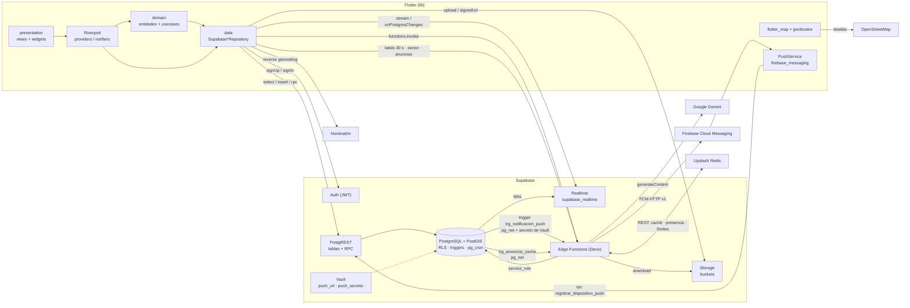

# ChauchaApp: documentación técnica de la arquitectura

Guía práctica de **cómo está implementada** cada tecnología en ChauchaApp. Cada afirmación remite a un archivo, tabla, función o política real.

- **App:** Flutter en la raíz del repositorio (web y Android).
- **Backend:** Supabase, proyecto `jfydcvrlfmnlbleecgqr`. Las migraciones están en `supabase/migrations/` y las Edge Functions en `supabase/functions/`.
- **Rutas:** las de este documento son relativas a la raíz del repositorio.

> **Estado de las integraciones (revisado el 14/11/2026)**
>
> | Integración | Estado |
> |---|---|
> | Supabase (Auth, PostgreSQL + PostGIS, RLS, Realtime, Storage, Edge Functions, `pg_cron`, `pg_net`, Vault) | En uso |
> | Google Gemini (visión) | En uso desde dos Edge Functions: valida la selfie y lee la cédula |
> | AWS Rekognition (`CompareFaces`) | En uso desde tres Edge Functions: compara el rostro con la cédula, al iniciar sesión y al postular |
> | Firebase Cloud Messaging | En uso. Es opcional en la app: sin las claves en `env.json`, la app funciona sin push |
> | OpenStreetMap: teselas y Nominatim | En uso desde el cliente |
> | Upstash Redis | **Implementado** en las Edge Functions: caché, presencia y límites de uso (sección 11). Funciona en modo *fail-open*: mientras no se carguen los secretos `UPSTASH_REDIS_REST_URL` y `UPSTASH_REDIS_REST_TOKEN`, todo sigue funcionando sin Redis |
> | Groq Vision, Brevo | **No existen en el código** (ni en Flutter, ni en las funciones, ni en las migraciones) |
> | Correo | Solo el de Supabase Auth: confirmación de cuenta y recuperación de contraseña |
>
> Las ocho Edge Functions (`validar-foto-rostro`, `comparar-rostro-cedula`, `verificar-rostro-sesion`, `verificar-rostro-postulacion`, `enviar-push`, `sector`, `anuncios` y `presencia`) tienen su código en `supabase/functions/` y están desplegadas.

---

## 1. Arquitectura general y flujo de datos

La app habla directamente con Supabase mediante `supabase_flutter`. No hay un backend propio intermedio. La lógica de negocio que debe ser confiable vive en la base de datos:

- **RPC `security definer`:** transacciones como aceptar una cotización.
- **Triggers:** transiciones de estado, puntos, notificaciones y protección de campos.
- **Políticas RLS:** quién lee y escribe qué.
- **Jobs de `pg_cron`:** tareas periódicas.

Lo que necesita claves secretas (Gemini y la cuenta de servicio de Firebase) corre en Edge Functions (Deno).

| Canal | Uso en ChauchaApp |
|---|---|
| **Auth** | `signUp`, inicio de sesión, `resetPasswordForEmail` y `resend` en `lib/features/auth/data/repositories/supabase_auth_repository.dart`. El JWT de la sesión es el que evalúan RLS y las RPC (`auth.uid()`). |
| **PostgREST** | Tablas: `from(...).select/insert/update`. RPC: `rpc('aceptar_cotizacion')`, `rpc('enviar_tarifa')`, `rpc('tecnicos_cercanos')`, `rpc('solicitudes_en_mapa')`, `rpc('horarios_ocupados')`, `rpc('iniciar_conversacion')`, `rpc('crear_reclamo')`, `rpc('completar_perfil')`, `rpc('actualizar_mi_radio')`, `rpc('registrar_dispositivo_push')`, `rpc('eliminar_solicitud')`. |
| **PostGIS** | Columnas `geography` (`usuarios.ubicacion_registro`, `perfiles_tecnicos.ubicacion_actual`, `solicitudes_servicio.ubicacion`) y funciones con `ST_DWithin` y `ST_Distance`. |
| **Realtime** | Publicación `supabase_realtime` con `mensajes`, `notificaciones`, `cotizaciones`, `solicitudes_servicio`, `reclamos` y `reclamo_mensajes`. |
| **Storage** | Buckets `perfiles`, `cedulas`, `evidencias`, `solicitudes`, `certificados`, `reclamos` y `anuncios`. Se acceden mediante `lib/core/storage/storage_service.dart` (subida y URL firmada o pública). |
| **Edge Functions** | `validar-foto-rostro` y `comparar-rostro-cedula`, que la app invoca con `functions.invoke`, y `enviar-push`, que llama la base con `pg_net`. |
| **Servicios externos** | Gemini (desde las funciones), FCM HTTP v1 (desde `enviar-push`), teselas OSM y Nominatim (desde el cliente). |



**Arranque:** `lib/main.dart` lee `env.json` (`--dart-define-from-file`; la plantilla es `env.example.json`). Inicializa Supabase con `SupabaseBootstrap.initialize(env)` y, si hay claves, `PushService.inicializar()`. Después monta la app en un `UncontrolledProviderScope`.

---

## 2. Frontend y gestión de estado (Flutter + Riverpod)

### 2.1 Clean Architecture por feature

`lib/features/` tiene un módulo por dominio: `admin`, `auth`, `catalogo`, `chat`, `cotizaciones`, `legal`, `notificaciones`, `perfil_puntos`, `publicidad`, `reclamos` y `solicitudes`. Cada uno se divide así:

| Capa | Contenido | Ejemplo real |
|---|---|---|
| `domain/entities` | Clases inmutables, sin Flutter ni Supabase | `solicitudes/domain/entities/solicitud.dart` (`EstadoSolicitud`), `servicio_completado.dart` |
| `domain/repositories` | Contratos (`abstract interface class`) | `solicitudes/domain/repositories/solicitud_repository.dart` |
| `domain/usecases` | Orquestación entre repositorios | `chat/domain/usecases/obtener_contexto_chat.dart`, `solicitudes/domain/usecases/obtener_feed_tecnico.dart` |
| `data/models` | Mapeo de filas JSON y columnas del `select` con sus joins | `cotizaciones/data/models/cotizacion_model.dart` (`columnas` con `perfiles_tecnicos!fk_cotizaciones_tecnico(...)`) |
| `data/repositories` | Implementación con Supabase y su `Provider` | `SupabaseSolicitudRepository` y `solicitudRepositoryProvider` |
| `presentation` | `providers/`, `views/`, `widgets/` | `solicitudes/presentation/views/solicitud_detalle_view.dart` |

El código compartido está en `lib/core/`:

- **Acceso a Supabase y errores:**
  - `core/supabase/supabase_guard.dart` traduce `PostgrestException` y `AuthException` a `AppFailure`.
  - `core/providers/core_providers.dart` expone `supabaseClientProvider`.
- **Geo y medios:** `core/geo/`, `core/media/`, `core/storage/`, `core/push/`.
- **Interfaz común:** `core/router/app_routes.dart`, `core/theme/tokens.dart` (tokens de diseño) y `core/widgets/`.

### 2.2 Riverpod 3 (providers escritos a mano, sin generación de código)

- **`Provider` para inyectar dependencias.** Por ejemplo `solicitudRepositoryProvider` y `cotizacionRepositoryProvider`. Las pruebas los sustituyen con `overrideWith` o `overrideWithValue` (ver `test/features/solicitudes/falsos.dart`).
- **`FutureProvider.autoDispose(.family)` para lecturas.**
  - `misSolicitudesProvider` (`solicitudes/presentation/providers/listas_provider.dart`).
  - `perfilPublicoProvider(tecnicoId)`.
  - `contextoChatProvider(conversacionId)`.
  - `feedProvider`, que espera `perfilTecnicoProvider.future` y llama al caso de uso `ObtenerFeedTecnico`.
  - Para aislar las cuentas, los providers observan `usuarioActualProvider.select((u) => u?.id)`: si cambia el usuario, se recalculan.
- **`AsyncNotifierProvider` para acciones con estado de carga.** `lib/features/chat/presentation/providers/tarifa_chat_provider.dart` define `accionesTarifaProvider`, un `AsyncNotifierProvider.autoDispose.family<AccionesTarifaNotifier, void, String>`:
  - `enviar(NuevaTarifa)` valida con `ReglasTarifa.motivoParaNoEnviar` y llama `cotizacionRepository.enviarTarifa`, que usa la RPC `enviar_tarifa`.
  - `confirmar()` acepta la oferta con la RPC `aceptar_cotizacion`. Es una sola transacción, y la base escribe el mensaje de sistema en el chat.
  - Todas las acciones pasan por `_ejecutar`, que bloquea acciones simultáneas y deja `AsyncError` con un `AppFailure` legible.
- **Invalidación de estado.** Después de una acción se usa `ref.invalidate(...)` o `ref.refresh(provider.future)`. Para el deslizar-para-recargar se usa `esperarSinError` (`core/utils/refrescar.dart`). Además, `lib/core/providers/sincronizacion_provider.dart` abre el canal Realtime `sincronizacion-datos`:
  - Escucha `PostgresChangeEvent.all` sobre `solicitudes_servicio` y `cotizaciones`.
  - Con un debounce de 400 ms invalida `misSolicitudesProvider`, `misTrabajosProvider`, `feedProvider` y `agendaProvider`.
- **Sesión y router.**
  - `sesionProvider` (`auth/presentation/providers/sesion_provider.dart`) modela `SesionEstado`.
  - `lib/app/app_router.dart` crea el `GoRouter` dentro de `routerProvider` y usa un `ValueNotifier` alimentado por `ref.listen(sesionProvider, ...)` como `refreshListenable`.
  - `resolverRedireccion` (`lib/app/route_guard.dart`) decide la redirección según el estado: verificando, sin sesión, perfil incompleto, selfie pendiente, o la zona del rol (`/cliente`, `/tecnico`, `/admin`).
  - Cada rol es un `InicioShell` con pestañas. Las rutas hijas (detalle, chat, perfil público, agenda, reclamos) se dibujan dentro del shell con `PantallaSecundaria` (`core/widgets/pantalla_secundaria.dart`).
  - El cambio de pestaña desde otra vista usa `pestanaSolicitadaProvider` (`lib/app/pestana_solicitada.dart`).

### 2.3 Mapas y geolocalización en el cliente

- **Paquetes:** `flutter_map` 8 con teselas de OpenStreetMap, `latlong2` y `geolocator`.
- **Ubicación actual:** `core/geo/ubicacion_service.dart` (`GeolocatorUbicacionService.obtenerActual()`) pide permiso y aplica un timeout.
- **Conversión con PostGIS:** `core/geo/geo_mapper.dart` convierte entre `LatLng` y PostGIS. `GeoMapper.toPostGisPoint` escribe `SRID=4326;POINT(lng lat)` y `GeoMapper.fromDb` lee GeoJSON o EWKB.
- **Barrio por geocodificación inversa:** `core/geo/sector_service.dart` consulta Nominatim (`nominatim.openstreetmap.org/reverse`). El resultado se guarda en `sectorProvider` (`core/widgets/etiqueta_sector.dart`), que espera 350 ms antes de consultar para no llamar a la red con cada toque.
- **Widgets de mapa:**
  - `core/widgets/mapa_ubicacion.dart`: selector y vista con círculo de radio.
  - `solicitudes/presentation/widgets/mapa_zona_tecnico.dart` y `mapa_zona_perfil.dart`: zona del técnico.
  - El inicio del cliente pinta los técnicos de `tecnicos_cercanos`, que devuelve la posición redondeada a una grilla con `ST_SnapToGrid(…, 0.005)` para no exponer la ubicación exacta.
- **Feed del técnico:** `ObtenerFeedTecnico` trae las solicitudes `abierta` o `cotizada` de sus oficios (la RLS ya las restringe) y filtra en el cliente por `GeoMapper.metrosEntre(...) <= perfil.rangoEfectivoM`. El mapa del técnico usa la RPC `solicitudes_en_mapa`, que filtra en el servidor con PostGIS.

---

## 3. Base de datos relacional y geoespacial (PostgreSQL + PostGIS)

### 3.1 Modelo principal (columnas reales)

| Tabla | Columnas clave |
|---|---|
| `usuarios` | `id` (= `auth.users.id`), `rol`, `nombres`, `apellidos`, `ciudad`, `foto_perfil_ruta`, `foto_rostro_validada`, `foto_rostro_motivo`, `verificado`, `verificado_manual`, `ubicacion_registro geography`, `es_vip`, `suspendido_desde`, `suspendido_hasta`, `creado_en` |
| `identidades` | `usuario_id`, `cedula`, `codigo_dactilar` (se crea con `completar_perfil`, que valida con `validar_cedula`) |
| `perfiles_tecnicos` | `usuario_id`, `nivel_id → niveles_gamificacion`, `tarifa_base`, `rango_cobertura_m`, `rango_bonus_m`, `ubicacion_actual geography`, `puntos`, `calificacion_promedio`, `total_resenas`, `verificado` |
| `tecnico_oficios` | `tecnico_id`, `oficio_id` |
| `solicitudes_servicio` | `cliente_id`, `oficio_id`, `descripcion`, `ubicacion geography`, `direccion_referencia`, `estado` (`abierta → cotizada → aceptada → por_confirmar → completada`, o `cancelada`), `creado_en`, `completada_en` |
| `cotizaciones` | `solicitud_id`, `tecnico_id`, `precio_base` (precio de la visita), `detalle`, `mano_obra`, `materiales`, `total`, `tarifa_enviada`, `fecha_servicio`, `inicio_visita`, `fin_visita`, `reagenda_inicio`, `reagenda_por`, `estado` (`pendiente`, `aceptada`, `rechazada`) |
| `resenas` | `solicitud_id`, `autor_id`, `destinatario_id`, `calificacion` (1 a 5), `valoracion` (`excelente`, `neutro`, `malo`, normalizada por `fn_resena_normalizar`), `comentario`, `etiquetas text[]` |
| `historial_puntos` | `tecnico_id`, `solicitud_id`, `puntos`, `motivo`. Es solo de inserción: el total se sincroniza con `fn_sync_puntos` |
| `niveles_gamificacion` | `nombre`, `puntos_minimos`, `comision_porcentaje`, `prioridad` |
| `conversaciones` / `mensajes` | Una conversación por par (`solicitud_id`, `tecnico_id`). `mensajes` tiene `tipo` (`texto` o `sistema`) y `datos jsonb` para los mensajes del ticket |
| `notificaciones` | `usuario_id`, `tipo`, `referencia_id`, `contenido`, `leida` |
| `eventos` | Bitácora de dominio (`solicitud_creada`, `negocio_cerrado`, `solicitudes_expiradas`, `reputacion_recalculada`) |
| `reclamos`, `reclamo_mensajes` | Tickets de garantía de 30 días (`20261113010000_reclamos_garantia.sql`) |
| `documentos_tecnico`, `comparaciones_rostro`, `dispositivos_push`, `anuncios` | Verificación, auditoría biométrica, tokens FCM y publicidad |

**Repositorio frente a base real:** el esquema base está en `20261107204355_remote_schema.sql` y `20261110045433_remote_schema.sql` (volcados del remoto), y los cambios posteriores en migraciones fechadas. Algunas funciones que hoy existen en la base, como `iniciar_conversacion`, no aparecen en esos archivos. Para tener el estado completo, regenerar el volcado con `supabase db pull`.

### 3.2 Consultas espaciales

- **Índices GIST:**
  - `perfiles_tecnicos.idx_perfiles_ubicacion` sobre `ubicacion_actual`.
  - `solicitudes_servicio.idx_solicitudes_abiertas_ubicacion` sobre `ubicacion`.
- **Radio efectivo del técnico:** se escribe en todas las funciones como `least(p.rango_cobertura_m + p.rango_bonus_m, 50000)`. `rango_bonus_m` lo recalcula cada noche `recalcular_reputacion_reciente()`: suma 500 m por cada reseña `excelente` de los últimos 90 días, con tope de 5000 m.

| Función | Consulta |
|---|---|
| `solicitudes_en_mapa()` (usada por la app) | Solicitudes `abierta` de los oficios de `auth.uid()`, con el técnico `verificado` y `st_dwithin(s.ubicacion, p.ubicacion_actual, <radio efectivo>)`. Devuelve distancia, latitud y longitud. Se llama en `solicitudes/data/repositories/supabase_mapa_tecnico_repository.dart` |
| `tecnicos_cercanos(p_lat, p_lng, p_oficio_id, p_radio_m, p_limite)` (usada por la app) | Técnicos `verificado` a `p_radio_m` de un punto, ordenados por `niveles_gamificacion.prioridad`, calificación y distancia. La posición se devuelve con `st_snaptogrid` para no exponerla. Se llama en `auth/data/repositories/supabase_inicio_repository.dart` |
| `solicitudes_cercanas(p_tecnico)` | Igual que el mapa, pero por id de técnico. **Existe en la base, pero la app no la llama** |
| `tecnicos_elegibles(p_solicitud)` | Técnicos del oficio que cubren la ubicación de una solicitud, por prioridad de nivel y distancia. **Existe en la base, pero la app no la llama** |

**Choques de horario:** la restricción de exclusión `ex_cotizaciones_sin_choque` impide que un técnico tenga dos visitas aceptadas superpuestas:

```sql
EXCLUDE USING gist (tecnico_id WITH =, tstzrange(inicio_visita, fin_visita) WITH &&)
  WHERE (estado = 'aceptada' AND inicio_visita IS NOT NULL)
```

`aceptar_cotizacion` hace la misma comprobación para el cliente (`tstzrange(...) && tstzrange(...)`), y `horarios_ocupados` alimenta el selector de hora.

### 3.3 Automatización en la base de datos

**Triggers principales (tabla, trigger y función):**

| Tabla | Trigger | Qué hace |
|---|---|---|
| `cotizaciones` | `trg_cotizacion_nueva` (`fn_nueva_cotizacion`) | Pasa la solicitud de `abierta` a `cotizada` y notifica al cliente |
| `cotizaciones` | `trg_cotizacion_aceptada` (`fn_cotizacion_aceptada`) | Pone la solicitud en `aceptada`, notifica al técnico (`cotizacion_aceptada`) e inserta en `mensajes` el mensaje `sistema` con `datos.accion = 'tarifa_aceptada'` |
| `cotizaciones` | `trg_cotizacion_validar`, `trg_cotizacion_precio_base`, `trg_cotizacion_ticket_cliente`, `trg_cotizacion_horario` | Validan, congelan `precio_base`, impiden que el cliente edite el ticket y obligan a que la visita solo se fije por RPC |
| `solicitudes_servicio` | `trg_solicitud_transicion` (`fn_transicion_estado`) | Máquina de estados: rechaza transiciones inválidas |
| `solicitudes_servicio` | `trg_completada_en`, `trg_solicitud_completada` (`fn_cierre_negocio`) | Marca `completada_en`, registra el evento `negocio_cerrado` y notifica `cierre` |
| `solicitudes_servicio` | `trg_solicitud_cierra_propuestas`, `trg_solicitud_creada`, `trg_solicitud_suspension` | Cierran las propuestas, registran el evento y bloquean a clientes suspendidos |
| `resenas` | `trg_resena_validar`, `trg_resena_normalizar` | Validan y normalizan la reseña |
| `resenas` | `trg_resena_reputacion` (`fn_reputacion`) | Recalcula `calificacion_promedio` y `total_resenas` |
| `resenas` | `trg_resena_puntos` (`fn_resena_puntos`) | `historial_puntos` +15, +5 o −15 según `valoracion`. Con 3 reseñas `malo` en 30 días suspende 7 días (`suspendido_desde` y `suspendido_hasta`) y notifica `sancion` |
| `historial_puntos` | `trg_historial_puntos_sync` (`fn_sync_puntos`) | Actualiza `perfiles_tecnicos.puntos` y el `nivel_id` según `puntos_minimos` |
| `mensajes` | `trg_mensaje_notificar` (`fn_notificar_mensaje`) | Crea la notificación `mensaje` para el otro participante |
| `notificaciones` | `trg_notificacion_push` (`fn_notificacion_push`) | Webhook a `enviar-push` (ver la sección 7) |
| `usuarios` | `trg_usuario_proteger` (`fn_proteger_usuario`) | Si quien actualiza no es admin, impide cambiar `rol`, `verificado`, `verificado_manual`, la suspensión y poner `foto_rostro_validada = true` |
| `usuarios` | `trg_usuario_foto`, `trg_usuario_foto_inmutable`, `trg_usuario_foto_reinicio`, `trg_usuario_foto_verificar` | Validan la ruta de la foto, la congelan una vez validada, reinician la validación si cambia y recalculan `verificado` |
| `perfiles_tecnicos` | `trg_perfil_tecnico_proteger` (`fn_proteger_perfil_tecnico`) | El técnico no puede tocar `verificado`, `puntos`, `nivel_id`, `calificacion_promedio` ni `total_resenas` |
| `documentos_tecnico` | `trg_documentos_verificar`, `trg_documentos_historial` | Verifican al técnico al aprobar sus documentos y guardan el historial |
| varias | `trg_auditoria` (`fn_auditoria`) | Auditoría en `usuarios`, `identidades`, `perfiles_tecnicos`, `solicitudes_servicio`, `cotizaciones` y `documentos_tecnico` |

**Tareas programadas (`cron.job`):**

| Job | Horario (UTC) | Comando |
|---|---|---|
| `expirar-solicitudes` | `0 5 * * *` | `expirar_solicitudes_viejas(30)`: cancela las solicitudes `abierta` o `cotizada` con más de 30 días, notifica `solicitud_expirada` y registra el evento |
| `recalcular-reputacion` | `30 5 * * *` | `recalcular_reputacion_reciente()`: recalcula `rango_bonus_m` y **`usuarios.es_vip`** (5 o más eventos `negocio_cerrado` en 90 días y ninguna reseña `malo`) |
| `avisar-fin-sanciones` | `0 * * * *` | `avisar_fin_sanciones()`: avisa cuando termina una suspensión |

Las migraciones son `20261112155808_expirar_solicitudes.sql`, `20261112155826_reputacion_periodica.sql` y `20261112160813_sanciones_semana.sql`.

---

## 4. Seguridad y control de acceso (Supabase Auth + RLS)

- **Identidad:** `auth.uid()` del JWT. Los ayudantes `security definer` (`mi_rol()`, `es_cliente_solicitud(id)`, `es_tecnico_cotizante(id)`, `es_tecnico_asignado(id)`, `es_tecnico_verificado()`) evitan la recursión entre políticas.
- **Escrituras sensibles por RPC:** van por funciones `security definer` que validan dueño y estado, como `aceptar_cotizacion` (con `select … for update`), `enviar_tarifa`, `crear_reclamo` y las `admin_*` con `exigir_admin()`. Las políticas solo cubren las operaciones directas.

**Políticas en tablas críticas:**

| Tabla | Política |
|---|---|
| `solicitudes_servicio` | `solicitudes_lectura`: el cliente dueño, el admin, el técnico que ya cotizó, o un técnico **verificado** con ese oficio si la solicitud está `abierta` o `cotizada`. `solicitudes_update_cliente` / `_tecnico`: el dueño o el técnico asignado, siempre sujetos a `fn_transicion_estado` |
| `cotizaciones` | `cotizaciones_lectura`: el técnico autor, el cliente de la solicitud o el admin. `cotizaciones_insert`: solo un técnico verificado, con `estado = 'pendiente'`. Los UPDATE están separados por rol y por estado |
| `conversaciones` / `mensajes` | Lectura para los participantes. `mensajes_insert` exige `autor_id = auth.uid()`, `tipo = 'texto'` y `datos IS NULL`: los mensajes `sistema` del ticket solo los escriben los triggers |
| `resenas` | Lectura para el autor, el destinatario o el admin (los perfiles públicos leen por la migración `20261112_resenas_lectura_publica.sql`). Inserción solo con `autor_id = auth.uid()`, validada por `fn_validar_resena` |
| `historial_puntos`, `documentos_tecnico`, `reclamos` | Lectura para el dueño o el admin. La revisión de documentos y la gestión de reclamos son solo del admin |
| `dispositivos_push` | `dispositivos_push_propios`: cada usuario ve y maneja solo sus propios tokens. El registro se hace con `registrar_dispositivo_push` |

**Storage (políticas sobre `storage.objects`):** se usa el primer segmento de la ruta como dueño, `(storage.foldername(name))[1] = auth.uid()::text`.

| Bucket | Público | Reglas |
|---|---|---|
| `cedulas` | No | Subir y actualizar solo en la carpeta propia. Leer: el dueño o el admin |
| `certificados` | No | Subir (solo técnicos), leer y borrar en la carpeta propia. El admin lee |
| `reclamos` | No | Subir en la carpeta propia. Leer: el dueño o el admin |
| `perfiles` | Sí | Subir en la carpeta propia. `perfiles_update_sin_validar` impide reemplazar una foto ya validada |
| `solicitudes` | No | Fotos del problema y evidencias de cierre (`<solicitud_id>/…`). **Las políticas actuales permiten a cualquier usuario autenticado subir y leer** (`bucket_id = 'solicitudes'`, sin filtrar por participante). La app usa URLs firmadas (`urlFirmada`), pero la regla no limita quién las pide |
| `evidencias` | No | Bucket heredado: la app actual no escribe en él. Tiene la misma apertura (`perfiles_evidencias_lectura`, `evidencias_subida`) |
| `anuncios` | Sí | Solo el admin sube y borra |

**Puntos débiles de privacidad que siguen abiertos:**

- `usuarios_lectura` es `USING (true)` y `perfiles_tec_lectura` también. Cualquier usuario autenticado puede leer `usuarios.ubicacion_registro` y `perfiles_tecnicos.ubicacion_actual` exactas.
- Las RPC de mapa sí redondean la posición, pero las tablas no la protegen.

---

## 5. Tiempo real y mensajería (Supabase Realtime)

- **Chat.** `lib/features/chat/data/repositories/supabase_chat_repository.dart`:
  - `mensajes(conversacionId)` usa `from('mensajes').stream(primaryKey: ['id']).eq('conversacion_id', …).order('enviado_en')`. El stream hace la consulta inicial y luego recibe los INSERT, y un `StreamTransformer` (`_errorDeConexion`) traduce los errores del canal a `AppFailure`.
  - `enviar()` hace un `insert` simple. La RLS fija autor y tipo, y `fn_notificar_mensaje` genera la notificación del destinatario.
  - La conversación se obtiene o se crea con `rpc('iniciar_conversacion')`.
- **Ticket en el chat.**
  - El técnico envía con `enviar_tarifa` y el cliente confirma con `aceptar_cotizacion`.
  - Los mensajes `sistema` con `datos.accion` los inserta la base (por ejemplo `fn_cotizacion_aceptada`). Llegan por el mismo stream y la UI los dibuja como tarjetas.
  - `contextoChatProvider` combina la conversación, la solicitud y la oferta mediante `ObtenerContextoChat`.
- **Ofertas en vivo:** `cotizaciones/data/repositories/ofertas_en_vivo.dart` usa `.stream(primaryKey: ['id'])` sobre `cotizaciones` en el detalle de la solicitud.
- **Estados de solicitudes y cotizaciones:** `sincronizacionProvider`, el canal `sincronizacion-datos` con `onPostgresChanges` descrito en la sección 2.2, invalida las listas y la agenda.
- **Notificaciones en la app:** `notificaciones/data/repositories/supabase_notificaciones_repository.dart` hace `.stream()` sobre `notificaciones`. `EscuchaNotificaciones` muestra el aviso y `notificacionesNoLeidasProvider` alimenta la campana y las insignias.
- **Reclamos:** `reclamos/data/repositories/supabase_reclamo_repository.dart` escucha `reclamos` y `reclamo_mensajes`.

Realtime respeta la RLS: cada suscriptor solo recibe las filas que podría leer.

---

## 6. Lógica serverless e inteligencia artificial (Edge Functions + Gemini)

| Función | `verify_jwt` | Fuente | Qué hace |
|---|---|---|---|
| `validar-foto-rostro` | Sí | `supabase/functions/validar-foto-rostro/index.ts` | Límite de 5 en 10 min y 20 por día por usuario, y caché del veredicto por SHA-256 de la imagen (sección 11). Lee `usuarios.foto_perfil_ruta`, descarga la imagen del bucket `perfiles` con `service_role` y la manda a Gemini (`generateContent` con `systemInstruction`, `temperature: 0`, respuesta JSON). Gemini aplica 7 reglas: una persona real, de frente, ojos abiertos, sin lentes, sin gorra, sin mascarilla, nítida. Prueba los modelos en orden (`MODELO_VISION_GEMINI` y los de respaldo) y reintenta ante 429 y 5xx. Guarda `foto_rostro_validada` y `foto_rostro_motivo` solo si la ruta no cambió (`.eq('foto_perfil_ruta', ruta)`). La invoca `supabase_usuario_repository.dart` |
| `comparar-rostro-cedula` | Sí | `supabase/functions/comparar-rostro-cedula/index.ts` | Validación automática de identidad. Con el frente, el reverso y la selfie enviados: compara el rostro de la selfie con el de la cédula (Rekognition, umbrales 85 y 60) y lee la cédula con Gemini (número, apellidos y nombres, código dactilar). Coteja exacto con lo registrado (`_shared/identidad.ts`) y decide: aprueba los tres documentos, rechaza el lado a repetir con su motivo (`documentos_tecnico.observacion`), pide corregir los datos (`corregir_datos_identidad`) o deja el caso al admin. Guarda solo el resultado del cotejo en `comparaciones_rostro` y avisa con una notificación `verificacion`. Límite de 6 por hora |
| `verificar-rostro-sesion` | Sí | `supabase/functions/verificar-rostro-sesion/index.ts` | Selfie en vivo al iniciar sesión contra la foto de perfil (Rekognition, umbral 90). Solo para cuentas verificadas; 3 intentos por sesión (`verificaciones_rostro_sesion`) |
| `verificar-rostro-postulacion` | Sí | `supabase/functions/verificar-rostro-postulacion/index.ts` | Confirmación de identidad al postular: foto con captura automática contra la foto de perfil (Rekognition, umbral 90). Si coincide, registra la confirmación en `verificaciones_postulacion` |
| `enviar-push` | No (la protege un secreto propio) | `supabase/functions/enviar-push/index.ts` | Ver la sección 7. No manda el push de un mensaje si el destinatario tiene ese chat abierto (presencia en Redis) |
| `sector` | Sí | `supabase/functions/sector/index.ts` | Barrio de un punto con Nominatim y caché compartida de 30 días. Respeta el límite global de Nominatim (1 consulta por segundo para toda la app) |
| `anuncios` | No (exige sesión en el GET; la invalidación usa el secreto de Vault) | `supabase/functions/anuncios/index.ts` | Anuncios vigentes por ubicación con caché de 5 min. `trg_anuncios_cache` la vacía al cambiar la tabla |
| `presencia` | Sí | `supabase/functions/presencia/index.ts` | Latidos, estado en línea por ids y técnicos en línea cerca (sección 11) |

**Cómo encajan en el flujo:**

- El resultado de la IA **no decide por sí solo**:
  - `foto_rostro_validada` solo puede ponerlo en `true` el sistema; `fn_proteger_usuario` lo bloquea para los usuarios.
  - `fn_verificar_por_foto` llama a `recalcular_verificacion`, que combina la cédula, la foto y la revisión del admin (`verificado_manual`).
- **Primer filtro en el cliente:** antes de subir, `lib/core/hilos/tareas.dart` (`esNitida`) calcula la varianza del Laplaciano sobre la imagen reducida a 400 px de ancho y rechaza las fotos con varianza menor a 100. Corre en otro hilo (sección 8.14). `core/media/selfie_camara.dart` toma la selfie con la cámara en vivo.
- **Evidencias de cierre:** **no pasan por IA**. `marcarTerminada` (`supabase_solicitud_repository.dart`) sube las fotos al bucket `solicitudes` con la ruta `<solicitud_id>/evidencia_…jpg`, las registra en `solicitud_archivos` (`trg_archivos_limite` limita la cantidad) y cambia el estado a `por_confirmar`. El cierre lo confirma el cliente.
- **Secretos de las funciones:** `GEMINI_API_KEY`, `MODELO_VISION_GEMINI` (opcional), `AWS_ACCESS_KEY_ID`, `AWS_SECRET_ACCESS_KEY`, `AWS_REGION` (Rekognition, con un usuario IAM que solo puede `CompareFaces`), `SUPABASE_SERVICE_ROLE_KEY`, `FIREBASE_SERVICE_ACCOUNT` y `APP_URL`. Ninguno está en la app.

---

## 7. Notificaciones y correo transaccional

### 7.1 Push con FCM (implementado)

1. **Origen único.** Todo evento termina en un `INSERT` en `notificaciones`. Lo hacen los triggers (`fn_nueva_cotizacion`, `fn_cotizacion_aceptada`, `fn_notificar_mensaje`, `fn_cierre_negocio`, `fn_resena_puntos`) y los jobs (`expirar_solicitudes_viejas`, `avisar_fin_sanciones`).
2. **Webhook.** `trg_notificacion_push` ejecuta `fn_notificacion_push()`. La función lee `push_url` y `push_secreto` de **Vault**; si faltan, no hace nada. Luego llama `net.http_post` de `pg_net`, que es asíncrono y no bloquea el INSERT, con el header `x-push-secreto`. Migraciones: `20261112153959_notificaciones_push.sql` y `20261112154019_push_secreto_en_vault.sql`.
3. **Edge Function `enviar-push`.**
   - Valida el secreto con la RPC `push_secreto_valido`.
   - Busca los tokens del destinatario en `dispositivos_push`.
   - Firma un JWT de la cuenta de servicio (`jose`, RS256) y lo cambia por un token OAuth de Google; ese token se reutiliza mientras no venza.
   - Envía el aviso con **FCM HTTP v1**, usando el título según `tipo` (mapa `TITULOS`) y `referencia_id` en los datos.
4. **Cliente.** `lib/core/push/push_service.dart`:
   - `PushService.inicializar()` arranca Firebase solo si hay claves.
   - `registrar(db)` obtiene el token (con VAPID en web) y lo guarda con `rpc('registrar_dispositivo_push')`. `olvidar` lo borra al cerrar sesión.
   - `FirebaseMessaging.onMessageOpenedApp` emite `ToquePush` y `InicioShell._abrirDesdePush` navega a la pestaña o al reclamo correspondiente.
   - Con la app abierta, el aviso llega por Realtime (sección 5).

### 7.2 Correo

- **Lo que existe:** el correo de **Supabase Auth**: confirmación de registro (`signUp`, y `resend` para reenviarlo) y recuperación de contraseña (`resetPasswordForEmail`), en `supabase_auth_repository.dart`. Usa las plantillas y el SMTP configurados en el panel de Supabase.
- **Lo que no existe:** correo transaccional por cambios de estado (Brevo u otro proveedor). Los avisos de estado llegan solo por push y por la campana de la app.
- **Contacto con soporte:** la app abre el cliente de correo del usuario con `mailto:` (`core/widgets/dialogos_info.dart`, `InfoApp.correoSoporte`).


---

## 8. Módulos de negocio implementados

Esta sección reúne las funcionalidades de la app (cliente, técnico y admin) y dónde vive cada una. Todas están en la rama `rediseno-chauchaapp`.

### 8.1 Flujo del servicio y ticket de visita

1. **Publicar.**
   - El cliente publica con `CrearSolicitudView` (`solicitudes/presentation/views/crear_solicitud_view.dart`) y `crearSolicitudProvider`.
   - Se inserta en `solicitudes_servicio`, y las fotos van a `solicitud_archivos` y al bucket `solicitudes`.
   - Para editar y eliminar se usan las RPC `editar_solicitud` y `eliminar_solicitud`.
2. **Postular.** El técnico postula con el precio de la visita (`cotizaciones.precio_base`) y su explicación (`detalle`). La regla `cotizaciones_insert` exige que sea un técnico verificado, y `fn_nueva_cotizacion` pasa la solicitud a `cotizada`.
3. **Chat.** El cliente abre el chat con `iniciar_conversacion`.
4. **Ticket.**
   - El técnico envía el ticket con `enviar_tarifa`, que llena `tarifa_enviada`, `fecha_servicio`, `inicio_visita` y `fin_visita`.
   - El cliente lo confirma con `aceptar_cotizacion` o lo rechaza con `rechazar_tarifa`. El técnico puede retirarlo con `cancelar_tarifa`.
5. **Cierre.**
   - El técnico marca el trabajo como terminado, con evidencias, y la solicitud pasa a `por_confirmar`.
   - El cliente confirma (`completada`) y salen las reseñas.
   - La garantía de 30 días corre desde `completada_en`.

**Estado actual del modelo:** el cobro dentro de la plataforma es **solo el de la visita**. `materiales` sigue en la tabla porque la columna generada `total` depende de ella; la interfaz ya no la pide.

### 8.2 Agenda, calendario y reagenda

- **Interfaz:**
  - `solicitudes/presentation/views/agenda_view.dart` con `CalendarioAgenda` (`widgets/calendario_agenda.dart`, paquete `table_calendar`) y `agendaProvider(esCliente)`.
  - Tickets por confirmar, próximas visitas y la lista del día elegido.
- **Horas ocupadas:** la RPC `horarios_ocupados(p_cotizacion_id, p_desde, p_hasta)` deshabilita los horarios ocupados en el selector.
- **Sin choques:**
  - Por técnico, la restricción `ex_cotizaciones_sin_choque` (sección 3.2).
  - Por cliente, la comprobación dentro de `aceptar_cotizacion`.
  - El trigger `trg_cotizacion_horario` (`fn_visita_solo_rpc`) obliga a cambiar la hora solo mediante las RPC.
- **Reagenda y cancelación:**
  - RPC: `proponer_reagenda` (llena `reagenda_inicio` y `reagenda_por`), `responder_reagenda(p_acepta)` y `cancelar_visita`.
  - `fn_aviso_visita` deja el mensaje de sistema en el chat y la notificación.
  - En Flutter, todo pasa por `supabase_cotizacion_repository.dart`.

### 8.3 Reseñas, puntos, niveles y sanciones

- **Reseñas:** bidireccionales, con estrellas de 1 a 5 y `etiquetas`. `fn_resena_normalizar` las traduce a `valoracion` (`excelente`, `neutro`, `malo`). El diálogo es `perfil_puntos/presentation/widgets/resena_dialog.dart` (`mostrarDialogoResena`).
- **Puntos:** `fn_resena_puntos` asigna +15, +5 o −15 en `historial_puntos`. Después `fn_sync_puntos` actualiza `perfiles_tecnicos.puntos` y `nivel_id`.
- **Niveles:** salen de `niveles_gamificacion` (`puntos_minimos`, `prioridad`, `comision_porcentaje`). La `prioridad` ordena los resultados de `tecnicos_cercanos` y `tecnicos_elegibles`.
- **Sanción:**
  - Con 3 reseñas `malo` en 30 días, la cuenta se suspende 7 días (`usuarios.suspendido_desde` y `suspendido_hasta`).
  - El cliente suspendido no puede publicar (`trg_solicitud_suspension`) y el técnico no puede postular (`trg_cotizacion_validar`, mediante `fn_validar_cotizacion`).
  - La app muestra `_BannerSuspension` en `InicioShell`, y el job `avisar-fin-sanciones` avisa cuando termina.
- **Calificación automática:** al cerrar un servicio aparece la hoja de calificación en ambos sentidos. El cliente la ve al confirmar el trabajo y el técnico al recibir la notificación `cierre`. Al abrir la app se piden las pendientes de los últimos 14 días (`mis_calificaciones_pendientes`, `perfil_puntos/presentation/widgets/escucha_calificaciones.dart`).
- **Reputación periódica:** `rango_bonus_m` y `es_vip`, ver la sección 3.3.

### 8.4 Verificación de identidad

1. **Datos de identidad:** el registro, o `completar_perfil` para las cuentas de Google, pide nombres, apellidos, cédula (`validar_cedula`) y código dactilar como aparecen en la cédula, y crea `identidades`.
2. **Documentos:** en "Verifica tu identidad" (`perfil_puntos/presentation/views/verificacion_view.dart`), frente, reverso y selfie en vivo. La selfie pasa el filtro de nitidez y `validar-foto-rostro`, y queda como foto de perfil.
3. **Validación automática:** al completar los documentos, `comparar-rostro-cedula` corre en segundo plano (el panel se cierra solo) y el resultado llega como notificación:
   - **Aprobada:** los documentos se aprueban, `recalcular_verificacion` marca `verificado` y la app muestra una celebración una sola vez por cuenta (`usuarios.verificacion_vista`, `marcar_verificacion_vista`) y la insignia "Verificado" (`core/widgets/insignia_verificado.dart`).
   - **Datos que no coinciden:** se abre sola la corrección (`corregir_datos_dialog.dart`, RPC `corregir_datos_identidad`) indicando qué campo falla, y se vuelve a validar.
   - **Rechazada:** el lado a repetir queda `rechazada` con su motivo.
   - **En revisión:** el admin decide en `admin_verificaciones_view.dart`.
4. **Rostro al iniciar sesión:** con la cuenta verificada, cada login pide una selfie en vivo (`verificar-rostro-sesion`); el guard de rutas no deja pasar sin ella.
5. **Al postular:** cada oferta del técnico exige confirmar su identidad (`auth/presentation/widgets/confirmar_identidad.dart`): la cámara frontal se abre y, tras una cuenta regresiva, toma la foto sola (`SelfieCamara(automatica: true)`); `verificar-rostro-postulacion` la compara con la foto de perfil. No se usa la huella ni el desbloqueo del celular: muchos técnicos tienen las huellas gastadas por el trabajo y no todos activan el desbloqueo facial; además, así se verifica a la persona y no al teléfono. El trigger `trg_cotizacion_verificacion` exige una confirmación de los últimos 10 minutos y cada una sirve para una sola oferta.
6. **Clientes:** `20261110145228_verificacion_clientes.sql`. Mientras falta, la app muestra el aviso `AvisoVerificacionCliente`.

### 8.5 Reclamos y garantía de 30 días

- **Base:** migración `20261113010000_reclamos_garantia.sql`.
  - Tablas `reclamos` (`numero` correlativo que la app muestra como `REC-0001`, `categoria`, `evidencias text[]`, `estado`, `resolucion`, `asesor_id`) y `reclamo_mensajes`.
  - Bucket privado `reclamos`.
- **RPC:**
  - `crear_reclamo`: solo el cliente o el técnico del servicio, y dentro de la garantía.
  - `responder_reclamo`.
  - `admin_gestionar_reclamo(p_reclamo_id, p_estado, p_mensaje)`.
- **Flutter:**
  - `reclamos/presentation/`: `TarjetaGarantia` (días restantes con `Garantia.diasRestantes`), `reportarProblema` (formulario con fotos), `MisReclamosView`, `ReclamoDetalleView` con el hilo en vivo y `EntradaMisReclamos`.
  - El admin usa `admin_reclamos_view.dart`.

### 8.6 Certificaciones del técnico

- **Base:** tabla `certificaciones_tecnico` (`nombre`, `entidad`, `anio`, `ruta_archivo`, `estado` pendiente, aprobada o rechazada) y bucket privado `certificados`. Migraciones `20261112_certificaciones.sql` y `20261112_bucket_certificados.sql`.
- **Flutter:** `perfil_puntos/presentation/providers/certificaciones_provider.dart` (`certificacionesAprobadasProvider` para el perfil público) y `widgets/certificaciones_widgets.dart`.
- **Pendiente:** los **+50 puntos** por certificación aprobada **no están implementados**. Ningún trigger sobre `certificaciones_tecnico` escribe en `historial_puntos`.

### 8.7 Publicidad (modelo de ingreso)

- **Base:** tabla `anuncios` (`titulo`, `descripcion`, `imagen_ruta`, `url_destino`, `anunciante`, `ubicacion` `home_cliente`, `home_tecnico` o `general`, `categoria`, `activo`, `fecha_inicio` y `fecha_fin`).
  - La política `anuncios_leer_vigentes` muestra solo lo activo y vigente.
  - Bucket público `anuncios` (máximo 1 MB; JPG, PNG o WebP), que solo sube el admin.
  - Migraciones `20261113000000_anuncios.sql` y `20261113030000_anuncios_externos.sql`.
- **Flutter:**
  - `publicidad/` con `anunciosProvider(UbicacionAnuncio)` y `BloquePublicidad`, un carrusel de hasta 5 piezas que no se puede cerrar.
  - El alto es fijo para que la página no salte: 190 px, o 240 si alguna pieza tiene "Ver más".
  - Sin anuncios vigentes muestra una pieza neutra, "Anuncia tu negocio aquí".

### 8.8 Notificaciones agrupadas por solicitud

- `notificaciones.referencia_id` apunta a la solicitud o a la cotización.
- `solicitudes/presentation/providers/novedades_provider.dart` (`novedadesPorSolicitudProvider`) cuenta las no leídas por solicitud para las insignias de "Mis solicitudes".
- `InicioShell` marca como leídas las notificaciones de una pestaña al entrar (`Destino.tiposNotificacion` y `marcaAlEntrar`).

### 8.9 Perfiles

- **Mi perfil del cliente** (`auth/presentation/views/perfil_cliente_view.dart`, con las secciones de `widgets/perfil_cliente_secciones.dart`):
  - Solicitudes activas (`solicitudesActivasProvider`: una consulta de ofertas con `deSolicitudes`).
  - Reseñas recibidas.
  - Historial de servicios: `historialServicios(clienteId, limite)` en `SupabaseSolicitudRepository`. Es **una sola consulta** con joins embebidos: `cotizaciones!fk_cotizaciones_solicitud!inner(...)` filtrado por `cotizaciones.estado = aceptada`, `perfiles_tecnicos`, `usuarios` y `resenas!fk_resenas_solicitud(...)` filtrado por `resenas.autor_id`.
  - Volver a contratar (`tecnicosRecurrentes`) y ubicación (actualiza `usuarios.ubicacion_registro`).
- **Perfil público del técnico** (`perfil_puntos/presentation/views/perfil_tecnico_publico.dart`): nivel, métricas, oficios, certificaciones, reseñas y verificación. No muestra puntos, faltas ni datos de contacto.

### 8.10 Panel de administración

- **Rol `admin`:** `InicioShell` con `admin_resumen_view.dart`, `admin_usuarios_view.dart`, `admin_verificaciones_view.dart`, `admin_solicitudes_view.dart` y `admin_reclamos_view.dart`.
- **RPC:** todas con `exigir_admin()` (`admin_resumen`, `admin_usuarios`, `admin_actualizar_usuario`, `admin_suspender_usuario`, `admin_eliminar_usuario`). `exigir_no_admin` impide actuar sobre otro admin. Migración `20261109150000_panel_admin.sql`.

### 8.11 Auditoría y bitácora de eventos

- **`auditoria`** (`tabla`, `registro_id`, `accion`, `datos_anteriores`, `datos_nuevos`, `cambiado_por`, `cambiado_en`): la llena `fn_auditoria` en las tablas sensibles. El índice `ix_auditoria_registro` es btree sobre (`tabla`, `registro_id`, `cambiado_en desc`).
- **`eventos`:** bitácora de dominio (sección 3.1). Sus filas quedan con `publicado_en` nulo; es la base del plan de la sección 10.

### 8.12 Interfaz web y páginas legales

- **Estructura web del cliente:** una sola página con scroll (`InicioShell._paginaClara`, `ScrollDePagina`).
  - Barra superior blanca, menú lateral, pie `PiePagina` (`lib/app/pie_pagina.dart`) y pantallas secundarias con `PantallaSecundaria`.
- **Páginas legales:** `features/legal/` (`TerminosView`, privacidad y diálogos de información del pie).
- **Diseño:** los tokens están en `core/theme/tokens.dart`. La tipografía Plus Jakarta Sans viene incluida en `assets/fonts/`, sin descargas en tiempo de ejecución, y las animaciones de login son de Lottie.

---

### 8.13 Darse de baja

`darse_de_baja()` desactiva la cuenta (`usuarios.dado_de_baja_en`) sin borrarla, porque las reseñas y el historial de otros apuntan a ella. Cancela las solicitudes activas del cliente; retira las ofertas del técnico y, si tenía visitas aceptadas, devuelve esas solicitudes a "cotizada" y avisa al cliente. La cuenta deja de estar verificada y la sesión no deja volver a entrar (`sesion_provider.dart`). Se ofrece en el perfil del cliente y en "Configuración de la cuenta" (`auth/presentation/widgets/baja_cuenta.dart`).

### 8.14 Procesamiento multihilo

`core/hilos` ejecuta con `isolate_manager` la detección de fotos borrosas y la preparación de cada foto antes de subirla (orientación, 1280 px, JPEG) en un grupo de hilos: isolates en Android y Web Workers en web. Varias fotos se preparan en paralelo y, si un hilo falla o no responde en 15 s, la tarea corre en el hilo principal. Los workers se generan con `dart run isolate_manager:generate --single` (`web/esNitida.js`, `web/prepararFoto.js`) y `tool/prueba_workers.dart` comprueba que funcionan en un navegador.

---

## 9. Pruebas, configuración y ejecución

- **Pruebas:** 53 archivos `*_test.dart` en `test/` (widgets, modelos, providers y el guard de rutas).
  - Los repositorios se sustituyen con falsos (`test/features/solicitudes/falsos.dart`) o con `overrideWith` sobre los providers.
  - Para que no haya red, `supabaseClientProvider` apunta a `http://localhost` con `autoRefreshToken: false`.
  - Ejecución: `flutter test`. Análisis estático: `flutter analyze` (reglas en `analysis_options.yaml`).
- **Configuración:** `env.json`, que no se sube al repositorio; la plantilla es `env.example.json`. Contiene `SUPABASE_URL`, `SUPABASE_ANON_KEY` y las claves `FIREBASE_*`, incluida `FIREBASE_VAPID_KEY` para web.
- **Ejecución en web:** `flutter run -d chrome --web-port=3000 --dart-define-from-file=env.json` (ver `README.md`).
- **Secretos del servidor:** en Supabase (Edge Functions) y en Vault (`push_url`, `push_secreto`). Nunca en la app.
- **Datos de prueba:** `supabase/semilla/` (`generar.py`, `05_vip.sql`, `06_niveles.sql`, `99_limpiar.sql`).

---

## 10. En implementación y planificado

| Componente | Estado | Cómo encaja en lo que ya existe |
|---|---|---|
| Publicador del outbox `eventos` hacia Redis | Planificado | Ver el detalle debajo. La caché, la presencia y los límites ya funcionan (sección 11) |
| +50 puntos por certificación | Pendiente | Trigger `after update` en `certificaciones_tecnico` (al pasar a `aprobada`) que inserte en `historial_puntos` con motivo `certificacion` y un tope por técnico |
| Correo transaccional (Brevo u otro) | No iniciado | Mismo enganche que el push: un trigger sobre `notificaciones`, o el consumidor de `eventos`, que llame a una Edge Function de correo |
| Comisión sobre el precio de la visita | Definido en el esquema, sin cobro | `niveles_gamificacion.comision_porcentaje` existe, pero no hay pasarela ni cálculo de cobro |
| Quitar `cotizaciones.materiales` | Pendiente | Redefinir la columna generada `total` antes de borrar la columna |
| Calificaciones ciegas | No iniciado | Ocultar las `resenas` en la política de lectura hasta que existan las dos, o pasen 7 días |
| Endurecer la privacidad | Pendiente | `usuarios_lectura` y `perfiles_tec_lectura` (`USING true`) exponen ubicaciones. Los buckets `solicitudes` y `evidencias` dejan leer y subir a cualquier autenticado. Ver la sección 4 |
| Volcado de esquema completo | Pendiente | `supabase db pull` para que las migraciones incluyan funciones como `iniciar_conversacion` |

### Publicador del outbox `eventos` (siguiente paso con Redis)

El esquema ya implementa el patrón **outbox**: cada hecho de negocio se escribe en `eventos` dentro de la misma transacción (`fn_solicitud_creada`, `fn_cierre_negocio`, `expirar_solicitudes_viejas`, `recalcular_reputacion_reciente`) con `publicado_en = NULL`, y el índice parcial `idx_eventos_pendientes` está pensado para leer solo lo pendiente. Lo que falta:

1. **Publicador.** Un job de `pg_cron` que llame con `pg_net` a una Edge Function `publicar-eventos`, o la propia función programada.
   - Lee `eventos where publicado_en is null order by creado_en limit N`.
   - Publica cada uno en Upstash Redis por su API REST (`UPSTASH_REDIS_REST_URL` y `UPSTASH_REDIS_REST_TOKEN` como secretos de la función). Por ejemplo, con `XADD` a un stream `chaucha:eventos`.
   - Marca `publicado_en = now()`.
2. **Uso:** alimentar consumidores externos (correo transaccional y métricas) sin cargar la base.

Este publicador es lo único de Redis que falta; la caché, la presencia y los límites de uso ya están implementados (sección 11).

---

## 11. Redis (Upstash): caché, presencia y límites de uso

**Por qué Redis y no Postgres o Realtime:**

- **Límites de uso:** son contadores de alta frecuencia que caducan solos (ventana deslizante). En Postgres serían escrituras y limpieza constantes; en Redis son operaciones atómicas con TTL.
- **Caché compartida:** los anuncios y los barrios son iguales para todos. Con Redis se consultan una vez para toda la app, no una vez por teléfono.
- **Presencia que el servidor puede leer:** Realtime Presence solo la ven los clientes suscritos al canal. `enviar-push` necesita saber si el destinatario tiene un chat abierto, y eso requiere un estado en el servidor.
- **Por qué Upstash:** las Edge Functions (Deno) no mantienen conexiones TCP; Upstash se usa por HTTP/REST.

**Diseño *fail-open*:** `_shared/redis.ts` (`obtenerRedis`, `conRedis`) devuelve el valor por defecto si faltan los secretos o Upstash falla. Así:

- Sin Redis no se cachea ni se limita, pero todo funciona.
- Redis nunca es la fuente de verdad, que sigue en Postgres.
- Probado en el despliegue: sin secretos, el trigger de anuncios recibe `200 {"invalidadas":0}`.

### Módulos compartidos (`supabase/functions/_shared/`)

| Archivo | Contenido |
|---|---|
| `redis.ts` | Cliente `@upstash/redis` 1.34.3, prefijo `chaucha:`, TTL por uso, `conRedis` (*fail-open*) y `comando` (REST crudo para `GEOSEARCH`) |
| `limite.ts` | `@upstash/ratelimit` 2.0.5, ventana deslizante. `limitar`, `limitarTodas` y `respuesta429` (header `Retry-After` y `reintentar_en`) |
| `cors.ts`, `auth.ts` | CORS común, `usuarioDe(req)` (JWT del usuario) y `clienteAdmin()` |
| `geo.ts` | `puntoDeEwkb`: lee `perfiles_tecnicos.ubicacion_actual` (EWKB hex de PostgREST) |
| `compartido_test.ts` | Pruebas Deno: *fail-open*, 429 y EWKB (`deno test supabase/functions/_shared`) |

### Claves

| Clave | Tipo | TTL | Uso |
|---|---|---|---|
| `chaucha:rl:{regla}:{uid}` | La gestiona `@upstash/ratelimit` | Ventana | Límites de uso |
| `chaucha:cache:sector:{lat3},{lng3}` | string | 30 días | Barrio de Nominatim (`""` = sin barrio) |
| `chaucha:cache:anuncios:{ubicacion}` | JSON | 5 min | Filas vigentes de `anuncios` |
| `chaucha:cache:selfie:{sha256}` | JSON | 7 días | Veredicto de Gemini para esa imagen exacta |
| `chaucha:pres:{uid}` | hash `rol, visto, conversacion, ubic, ubic_en` | 90 s | En línea: lo renueva cada latido |
| `chaucha:pres:visto` | zset `uid → ms` | Se recorta a 30 días | "Activo hace X" |
| `chaucha:pres:tecnicos` + `chaucha:pres:tecnicos:latido` | GEO + zset | Limpieza por latido vencido | Técnicos verificados en línea, por posición |

### Límites de uso

| Función | Regla | Motivo |
|---|---|---|
| `validar-foto-rostro` | 5 en 10 min y 20 por día por usuario. No cuenta si la foto ya está validada | Cada revisión es una llamada a Gemini |
| `comparar-rostro-cedula` | 3 por hora por usuario | Una llamada a Gemini por comparación |
| `sector` | 30 por minuto por usuario y **1 por segundo global** hacia Nominatim | Política de uso de OpenStreetMap |
| `presencia` (POST) | 6 por minuto por usuario | El latido es cada 30 s |

En Flutter, `supabaseGuard` (`core/supabase/supabase_guard.dart`) traduce `FunctionException` con 429 a "Hiciste muchos intentos seguidos. Espera N s…" usando `mensajeFuncion`.

Lo que va directo a PostgREST (crear solicitudes, cotizaciones, mensajes) **no pasa por Redis**: ahí la protección sigue siendo RLS, triggers y sanciones.

### Caché

- **Barrio.** `SectorService` (`core/geo/sector_service.dart`) llama a la función `sector` cuando hay sesión. Si falla, consulta Nominatim directo como antes. Mantiene su caché en memoria.
- **Anuncios.**
  - `SupabaseAnuncioRepository.vigentes` usa la función `anuncios` (GET), y si no responde lee la tabla.
  - La vigencia se revisa otra vez en el cliente (`AnuncioModel.vigente`).
  - **Invalidación:** `trg_anuncios_cache` (migración `20261114000000_redis_cache_anuncios.sql`, `for each statement`) llama con `pg_net` a `anuncios?invalidar=1`. Reutiliza `push_url` y `push_secreto` de Vault.
- **Selfie.** `validar-foto-rostro` calcula el SHA-256 del archivo y reutiliza el veredicto si ya existe. Un reintento con la misma foto no vuelve a llamar a Gemini.

### Presencia

- **Función `presencia`:**
  - `POST {conversacion_id?}` es el latido.
  - `POST {salir: true}` desconecta.
  - `GET ?ids=` devuelve `{en_linea, visto}`, para hasta 50 ids.
  - `GET ?lat&lng&radio&oficio` devuelve el conteo e ids de técnicos verificados en línea. **Nunca devuelve coordenadas.**
- **Flutter** (`core/presence/presencia_service.dart`):
  - `presenciaProvider` lo enciende `InicioShell` y manda un latido cada 30 s mientras la app está visible (`AppLifecycleListener`: `onResume` y `onHide`).
  - `conversacionAbiertaProvider` lo fija `ChatPanel`. Al abrir o cerrar un chat se manda un latido enseguida.
  - `sesionProvider.cerrarSesion` llama a `salir()` antes de cerrar la sesión.
  - `estadoPresenciaProvider(id)` se refresca cada 30 s y `tecnicosEnLineaProvider` cada 60 s.
- **Interfaz:**
  - `IndicadorPresencia` ("En línea" o "Activo hace X") en el chat.
  - Píldora "En línea" en el perfil público del técnico.
  - "N están en línea ahora" en la portada del inicio del cliente.
- **Push:** `enviar-push` omite el aviso `mensaje` si `pres:{destinatario}.conversacion` es esa conversación. Responde `{omitido: 'viendo_chat'}`.

### Configuración

```bash
supabase secrets set UPSTASH_REDIS_REST_URL=https://<base>.upstash.io UPSTASH_REDIS_REST_TOKEN=<token>
supabase functions deploy validar-foto-rostro comparar-rostro-cedula sector presencia --use-api
supabase functions deploy enviar-push anuncios --use-api --no-verify-jwt
```

Los secretos van solo en Supabase, nunca en `env.json` ni en la app.
